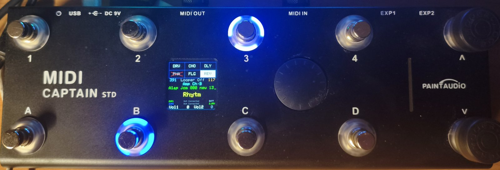
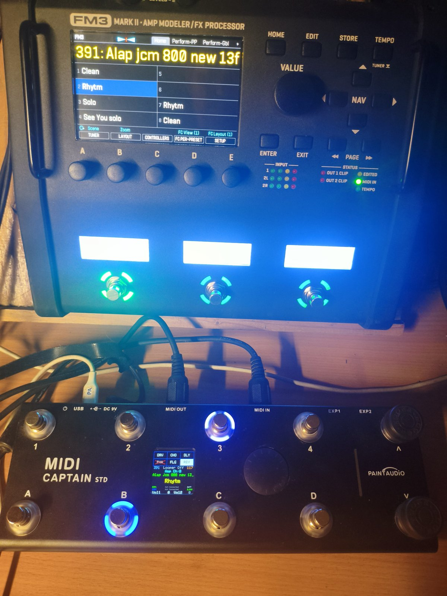
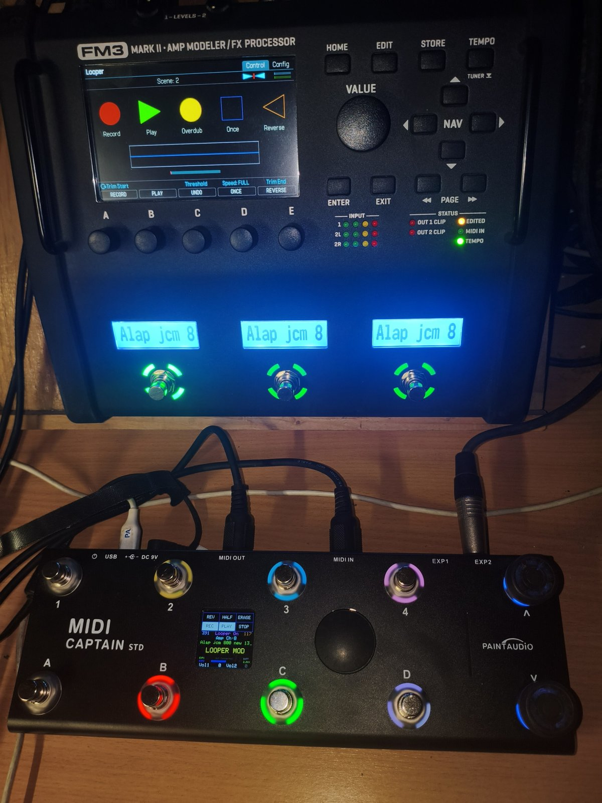
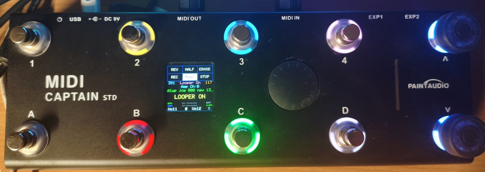
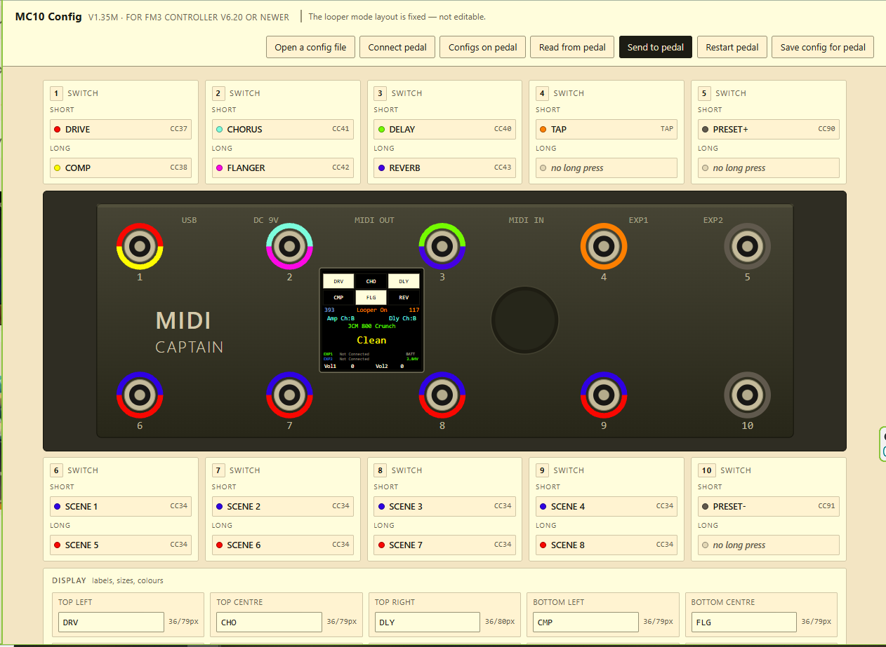

# MC10-FM3

Custom firmware for the **PaintAudio MIDI Captain 10** (MC10), made to control a **Fractal Audio FM3**, with a browser-based config editor. No compiling needed.

> Unofficial project. It is not made by, or affiliated with, PaintAudio or Fractal Audio Systems.

## What it is

A foot controller layout built for playing live, treating the MC10 like a small pedalboard:

- **Presets and scenes** on dedicated switches. The display and LEDs follow what the FM3 actually does: preset, scene, effect on/off, channels, tempo.
- **Six dedicated "stomp-box" effects** on switches 1–3: a short press is one effect, a long press another. Each has its own place and LED, so you step on it without reading the display.
- **Combos** (two switches at once) for amp and delay channels, looper on/off and looper mode.
- **Live looper mode**: REC, PLAY, STOP, ONCE, REVERSE, HALF and ERASE on their own switches. The LEDs and display follow the FM3 looper, whether you press on the pedal or on the FM3.
- **Change the layout without compiling**: the config editor is a single HTML file that talks to the pedal over USB. You can keep several configs on the pedal and pick one at start-up with the encoder.

## Photos

| Normal mode, following the FM3 preset and scene | Looper mode, following the FM3 looper |
|---|---|
|  |  |

## Downloads

| What | Where |
|---|---|
| Firmware (`.uf2`) | [Latest release](https://github.com/farkasgyulaattila74/MC10-FM3/releases/latest) |
| Setup guide (PDF, 9 pages) | [docs/MC10_Setup_Guide_v3.1.pdf](docs/MC10_Setup_Guide_v3.1.pdf) |
| Config editor (HTML) | [editor/mc10_konfig_editor_v1.35m.html](editor/mc10_konfig_editor_v1.35m.html) |

**Read the setup guide first.** It covers the FM3 settings, assigning the effects, loading the firmware, the editor, and troubleshooting.

## What you need

- PaintAudio MIDI Captain 10
- Fractal FM3
- **Two** 5-pin MIDI cables: pedal OUT → FM3 IN **and** FM3 OUT → pedal IN. The pedal needs both directions to follow the FM3; with only one cable the display shows `NOT SYNC`.
- A USB cable that carries data (many are charge-only)
- Chrome or Edge on a computer, for the editor

## Quick start

1. **FM3 settings** (Setup → MIDI/Remote): MIDI channel 1, Program Change on, Ignore Redundant PC off. Guide, section 2.
2. **Assign the effects** on the FM3 to the CCs the pedal sends. Guide, section 3.
3. **Load the firmware**: the same procedure as PaintAudio's own firmware updates, using this `.uf2`. Guide, section 4.
4. Connect both MIDI cables and power up. The display shows the FM3 preset name and scene.

## Default layout

Switches are numbered 1–5 on the top row and 6–10 on the bottom row.

| Switch | Short press | Long press |
|---|---|---|
| 1 | Drive | Compressor |
| 2 | Chorus | Flanger |
| 3 | Delay | Reverb |
| 4 | Tap tempo | — |
| 5 | Preset + | — |
| 6 | Scene 1 | Scene 5 |
| 7 | Scene 2 | Scene 6 |
| 8 | Scene 3 | Scene 7 |
| 9 | Scene 4 | Scene 8 |
| 10 | Preset − | — |

| Two switches together | What it does |
|---|---|
| 5 + 10 | Looper block on / off |
| 1 + 6 | Enter or leave looper mode |
| 6 + 7 | Amp channel A ↔ B |
| 7 + 8 | Amp channel C ↔ D |
| 8 + 9 | Delay channel A ↔ B |
| 9 + 10 | Delay channel C ↔ D |

In the editor you can change which effect and FM3 block sits on switches 1–3, the CC numbers and MIDI channel, the channel combos, the display, the colours and the start-up preset. The roles of switches 4–10 are fixed.

## Config editor

Download the HTML file and open it in Chrome or Edge. Nothing to install, it works offline and uploads nothing. Hold switch 1 while powering the pedal on to enter config mode, then press **Connect pedal**. Full walkthrough in the guide, section 6.

## License

Free for personal, non-commercial use. You may not sell it, bundle it into a paid product, or use it to earn money.

Source code is not published. Support and collaboration are at my discretion.

Third-party components (such as the arduino-pico core) keep their own licenses.

## Feedback

Questions and bug reports: use **Issues** on this page.
